

# 📖 AudioVisualizer manual
### version 0.77 · by [mtyas](https://mtyas.com)

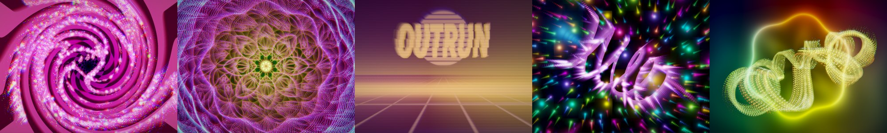

[⬅️ Back to the README](../README.md) · [⬇️ Download](../../../releases/latest) · [☕ Ko-fi](https://ko-fi.com/mtyas)

---

## Contents

1. [Install](#1-install)
2. [Your first five minutes](#2-your-first-five-minutes)
3. [The window at a glance](#3-the-window-at-a-glance)
4. [The output window](#4-the-output-window)
5. [Compose: layers](#5-compose-layers)
6. [Style: effects](#6-style-effects)
7. [Animate: making it react](#7-animate-making-it-react)
8. [Patch: the node graph](#8-patch-the-node-graph-advanced)
9. [Library: presets](#9-library-presets)
10. [Webcam, video and MIDI](#10-webcam-video-and-midi)
11. [Keyboard shortcuts](#11-keyboard-shortcuts)
12. [Troubleshooting](#12-troubleshooting)
13. [About, support and licence](#13-about-support-and-licence)

---

## 1. Install

Download the zip for your system from the [Releases page](../../../releases/latest) and copy the files where your DAW looks for plugins.

| System | VST3 | CLAP | AU | Standalone |
|---|---|---|---|---|
| 🪟 **Windows** | `C:\Program Files\Common Files\VST3` | `C:\Program Files\Common Files\CLAP` | - | run `AudioVisualizer.exe` |
| 🍎 **macOS** | `~/Library/Audio/Plug-Ins/VST3` | `~/Library/Audio/Plug-Ins/CLAP` | `~/Library/Audio/Plug-Ins/Components` | open `AudioVisualizer.app` |
| 🐧 **Linux** | `~/.vst3` | `~/.clap` | - | run `AudioVisualizer` |

Then rescan plugins in your DAW. The plugin is called **AudioVisualizer** (vendor *mtyas*).

> 🍎 **macOS:** the build is not signed or notarized. After copying, run `xattr -dr com.apple.quarantine <file>` on the plugin or app once (or right-click → Open).

**Inputs:** a stereo **Main** input plus two optional stereo **Sidechain** inputs, and MIDI in. Audio passes through untouched, so it is safe to put anywhere. Put it on a bus or aux to react to a whole mix.

> 🔇 In the **standalone** app the input is muted at first to avoid feedback. Use **Options → Audio/MIDI settings** to pick a device and turn it on.

## 2. Your first five minutes

1. **Open Output.** The picture appears in its own window. It starts **on top of other windows**.
2. **Pick a preset** from the top bar (or use `<` and `>`). There are 42.
3. Play something. The picture moves with the sound.
4. Open **Compose** and change a few sliders. Everything you do is undoable (`Ctrl+Z`).
5. Open **Animate** or **right-click a slider** to make *anything* react to sound, MIDI or motion.
6. Happy? Click **Save…** to keep it as your own preset.

## 3. The window at a glance

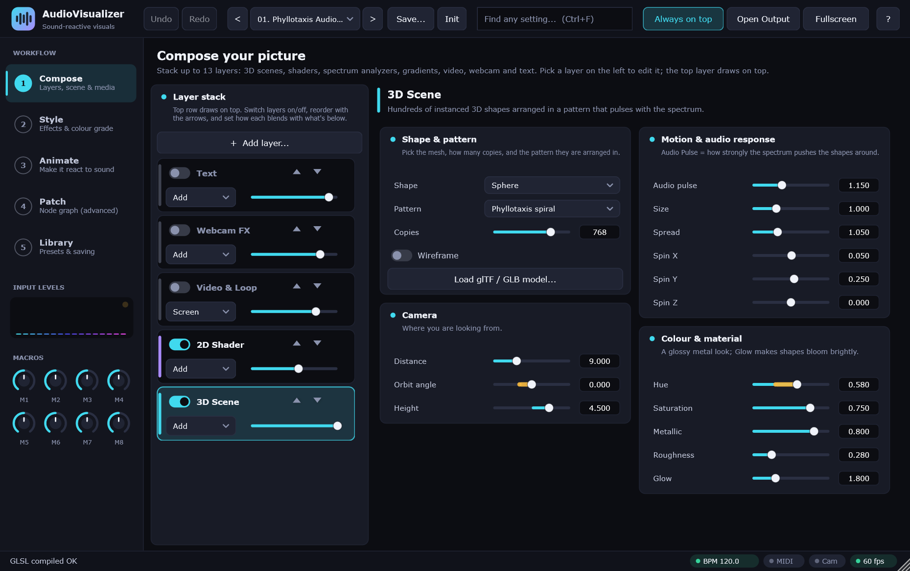

| Area | What it does |
|---|---|
| **Top bar** | Undo / Redo · preset picker (`<` `>` Save… Init) · **search** (`Ctrl+F`) · **Always on top** · **Open Output** · **Fullscreen** · **`?`** quick tour |
| **Left rail: Workflow** | The five pages, in the order you'd normally use them |
| **Left rail: Input levels** | Live spectrum of what the plugin hears, plus a dot that flashes on transients |
| **Left rail: Macros** | Eight free knobs (M1–M8). Use them as modulation sources, or map them in your DAW |
| **Left rail: About & support** | Credits and links (also opens when you click the logo) |
| **Status bar** | What just happened, plus tempo, MIDI, camera and frame-rate indicators |

**Tips for finding things**

- Press **`Ctrl+F`** and type a word ("bloom", "font", "mirror"). Pick a result and the app jumps to it and highlights it.
- **Hover** any control for a tooltip with its range and default.
- **Double-click** a slider to reset it. **Right-click** it to modulate it.
- A little **amber bar** on a slider shows its live, modulated value.

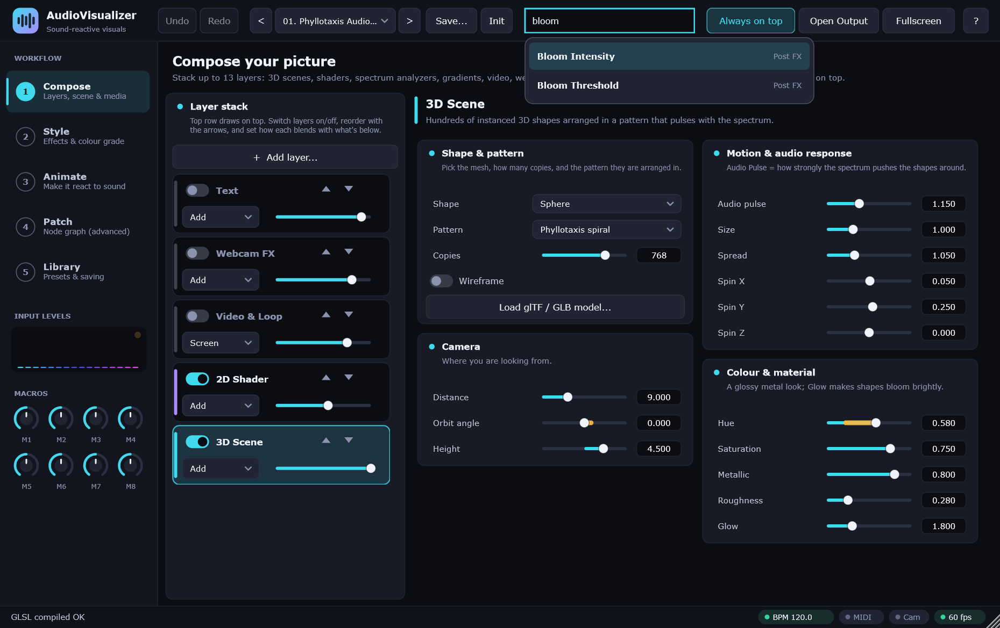

## 4. The output window

Click **Open Output** to see the visuals in their own window.

| Control | What it does |
|---|---|
| **Always on top** | Keeps the window above everything, including your DAW. On by default. Press **`T`** in the output window to toggle |
| **Fullscreen** | Fills the screen. **`F11`** or **`Alt+Enter`** toggles, **`Esc`** leaves |
| **Mouse** | Position and button become modulation sources: `mouse.x`, `mouse.y`, `mouse.down` |

You can drag the window to a second monitor or a projector and go fullscreen there.

## 5. Compose: layers

The **layer stack** is on the left. **The top row draws on top.** Each row has:

- a **switch** to show or hide the layer,
- **▲ ▼** arrows to reorder it,
- a **blend mode** (how it mixes with what's below) and an **opacity** slider,
- an **✕** to remove it (layers you added; the original five stay).

Click **+ Add layer…** to add up to **13 layers**. You choose the kind each time.

### Layer kinds

| Kind | What it is |
|---|---|
| 🔷 **3D Scene** | Hundreds of instanced 3D shapes arranged in a pattern that pulses with the spectrum |
| 🎆 **2D Shader** | Procedural generators. The original 2D layer can also run your own GLSL |
| 📈 **Spectrum Analyzer** | The 16 analysis bands drawn as bars, mirrored bars, a radial burst, a smooth line or a dot matrix |
| 🌈 **Gradient / Fill** | Solid colour, linear / radial / angular gradients, stripes, checkerboard or rings |
| 🎞️ **Video & Loop** | A video or image file, a live webcam, or a recorded loop |
| 📹 **Webcam FX** | The camera picture with neon edges, key, posterize and audio warp |
| 🔤 **3D Text** | Kinetic type with any installed font |

### Blend modes

| Mode | Effect |
|---|---|
| **Add** | Brightens: light on top of light |
| **Screen** | A softer brighten that never clips |
| **Multiply** | Darkens / tints what's below |
| **Overlay** | Adds contrast and colour; great for gradients |
| **Alpha** | Normal "paint over" using the layer's own transparency |
| **Difference** | Inverts where the layer is bright |

### 3D Scene

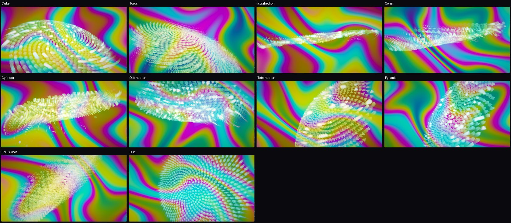

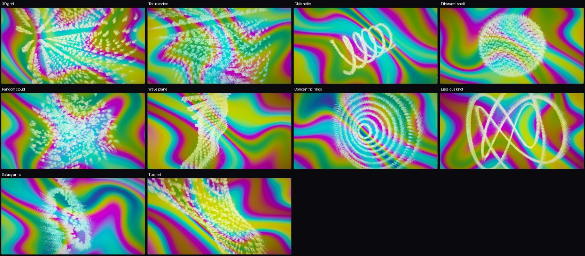

- **Shape:** sphere, cube, torus, icosahedron, cone, cylinder, octahedron, tetrahedron, pyramid, torus knot, disc, or **your own glTF / GLB model**
- **Pattern:** phyllotaxis spiral, 3D grid, torus vortex, DNA helix, Fibonacci shell, random cloud, wave plane, concentric rings, Lissajous knot, galaxy arms, tunnel
- **Copies**, **Audio pulse** (how hard the spectrum pushes the shapes), size, spread, spin X/Y/Z
- **Camera:** distance, orbit angle, height
- **Material:** hue, saturation, metallic, roughness, glow

### 2D Shader

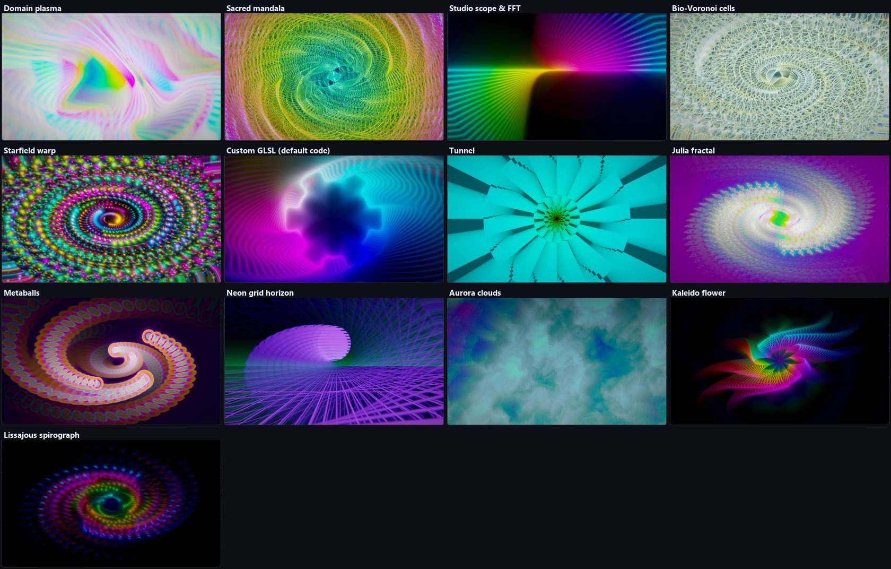

Twelve built-in generators (plasma, mandala, scope, Voronoi cells, starfield, tunnel, Julia fractal, metaballs, neon grid, aurora clouds, kaleido flower, Lissajous spirograph), each with speed, scale, complexity, palette shift and two "morph" knobs.

The **original** 2D layer also has **Custom GLSL**: write a Shadertoy-style `mainImage()` in the editor and click **Compile & apply**. You can also load a `.glsl`, `.frag` or ISF `.fs` file, which hot-reloads when you save it. Uniforms include `iTime`, `iResolution`, `u_rms`, `u_env`, `u_bands[16]` and more.

### Text and fonts

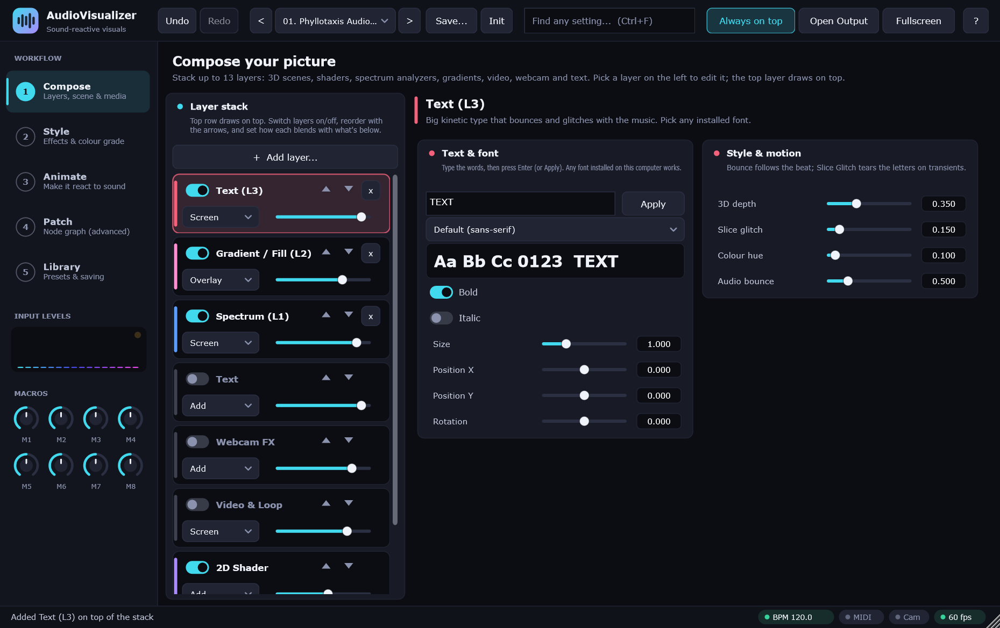

Type your words, press **Enter**, then choose a **font**. The list contains every font installed on your computer. **Bold** and **italic** are switches. Each text layer has its own words and font, so you can mix typefaces on one screen.

### Spectrum and Gradient layers

- **Spectrum:** style, gain, thickness, glow, hue and hue spread, size, vertical position, rotation.
- **Gradient / Fill:** style, scale, angle, scroll / spin speed, two hues, saturation, brightness and **audio reaction**. Set its blend to *Overlay* or *Multiply* to tint what's underneath.

### Video & Loop

Source choices: **GPU live loop buffer**, two procedural decks, a **loaded video / image file**, or **Live webcam (direct)**. See [Webcam, video and MIDI](#10-webcam-video-and-midi).

## 6. Style: effects

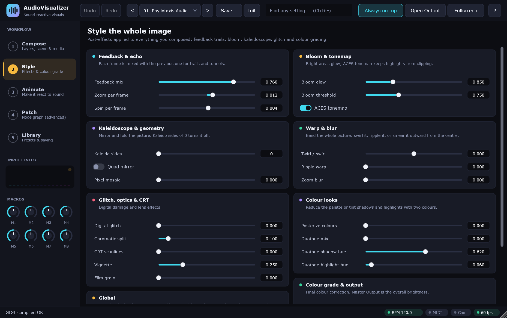

Effects applied to the whole picture, after the layers are combined.

| Group | What's in it |
|---|---|
| **Feedback & echo** | Each frame mixes with the last: trails, tunnels, spin |
| **Bloom & tonemap** | Bright areas glow; ACES keeps highlights from clipping |
| **Kaleidoscope & geometry** | Kaleido sides, quad mirror, pixel mosaic |
| **Warp & blur** | Twirl, ripple warp, zoom blur |
| **Glitch, optics & CRT** | Digital glitch, chromatic split, scanlines, vignette, film grain |
| **Colour looks** | Posterize, and a **duotone** that tints shadows and highlights |
| **Colour grade & output** | Hue rotate, saturation, contrast, invert strobe, master output |
| **Global** | **Animation speed** for every animated layer |

## 7. Animate: making it react

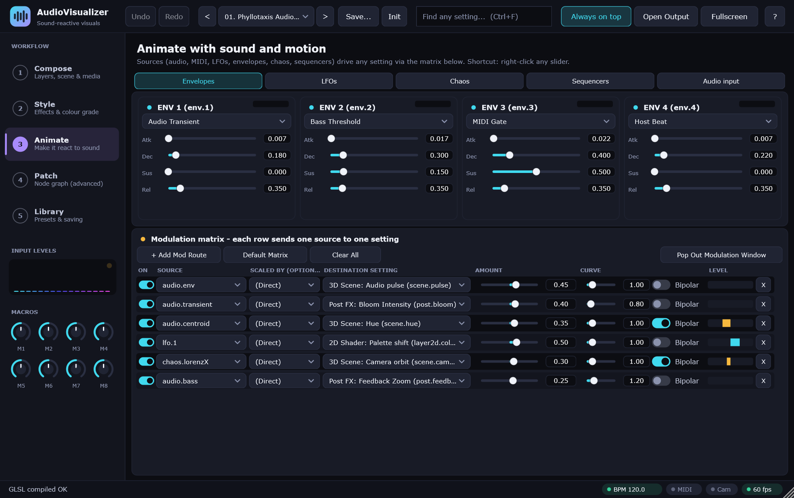

**Sources** make signals. The **matrix** connects a source to a setting ("destination").

### The quick way

**Right-click any slider** → choose a source. A route is created with a sensible amount, and the slider shows an amber bar for the live value. Fine-tune it later on the Animate page.

### The matrix

Each row sends one source to one setting:

| Column | Meaning |
|---|---|
| **On** | Enable the route |
| **Source** | What to listen to |
| **Scaled by** | Optional second source that multiplies the first (leave as *Direct*) |
| **Destination** | The setting that moves |
| **Amount** | How far it moves, as a fraction of the setting's range (negative inverts) |
| **Curve** | Shapes the response (below 1 = more sensitive, above 1 = only big hits) |
| **Bipolar** | Moves the setting both up and down around its base value |
| **Level** | Live meter of the route's output |

Only settings from layers that exist are offered as destinations.

### Sources

| Group | Examples |
|---|---|
| **Audio analysis** | `audio.rms`, `peak`, `env`, `transient`, `centroid`, `flux`, `mid`, `side`, `width`, `left`, `right`, `correlation`, `noisiness`, `rolloff`, `bass`, `subBass`, `presence`… |
| **Drum triggers** | `audio.kick`, `audio.snare`, `audio.hat`, `audio.peakHold` |
| **Spectrum bands** | `band.0` … `band.15` |
| **Envelopes** | `env.1` … `env.4` |
| **LFOs** | `lfo.1` … `lfo.4` |
| **Chaos** | `chaos.lorenzX/Y/Z`, `rossler`, `duffing`, `drift1/2` |
| **Sequencers** | `seq.1`, `seq.2` |
| **Macros** | `macro.1` … `macro.8` |
| **Tempo clocks** | `clock.beat`, `2beat`, `bar`, `2bar`, `4bar`, `triBeat`, `sineBar`, `pulse` |
| **Noise & time** | `noise.slow/medium/fast/perBeat`, `time.minute`, `slowSine`, `fastSine` |
| **MIDI** | `midi.gate`, `note`, `velocity`, `trigger`, `pitchbend`, `aftertouch`, `modwheel`, `sustain`, plus `note.N` and `cc.N` |
| **Host** | `host.bpm`, `host.beat`, `host.playing` |
| **Webcam** | `cam.motion`, `cam.x/y`, `pose.headX/Y`, `leftHandX/Y`, `rightHandX/Y`, `handSpread`, `bodyLean`, `gestureWave`, `proximity` |
| **Mouse** | `mouse.x`, `mouse.y`, `mouse.down` (over the output window) |

### Source editors

Use the tabs above the matrix:

- **Envelopes (4):** attack / decay / sustain / release, triggered by *audio transient*, *MIDI gate*, *host beat*, *bass threshold* or *auto loop*.
- **LFOs (4):** sine, triangle, saw, ramp, square, sample & hold, smooth random, exp pulse. Free rate or **tempo-synced**.
- **Chaos:** Lorenz, Rössler, Duffing and drift generators with a live phase scope.
- **Sequencers (2):** 16 steps, glide, direction (forward, reverse, ping-pong, random), tempo sync.
- **Audio input:** choose what is analysed (**Mid, Side, L, R, Sidechain 1, Sidechain 2**), an optional low / high / band-pass filter, attack and release, and transient sensitivity.

## 8. Patch: the node graph (advanced)

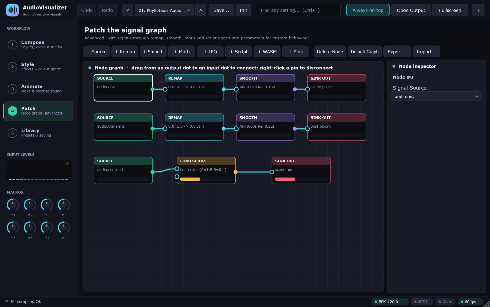

For behaviour the matrix can't express. Drag from a node's output dot to another node's input dot; right-click a pin to disconnect.

| Node | Purpose |
|---|---|
| **Source** | Reads any source signal |
| **Constant** | A fixed number |
| **Remap** | Map an input range to an output range (with a curve) |
| **Smooth** | Attack / release smoothing |
| **Math** | Add, subtract, multiply, min, max |
| **LFO** | A tiny oscillator |
| **Script** | A short formula, with a state variable |
| **WASM** | A sandboxed WebAssembly module (see `ContentPack/Scripts`) |
| **Sink** | Sends the value to a named setting |

**Script nodes** use variables `x`, `y` (the two inputs), `t`, `dt`, `a b c d` (node knobs), `rms`, `env`, `trans`, `beat` and `s` (state kept between frames), and functions `sin cos tan abs sqrt floor fract exp min max pow step clamp mix smoothstep`. Example: `s = s * 0.92 + x * 0.08` then `out = sin(t * a + s * 6.283) * b`.

## 9. Library: presets

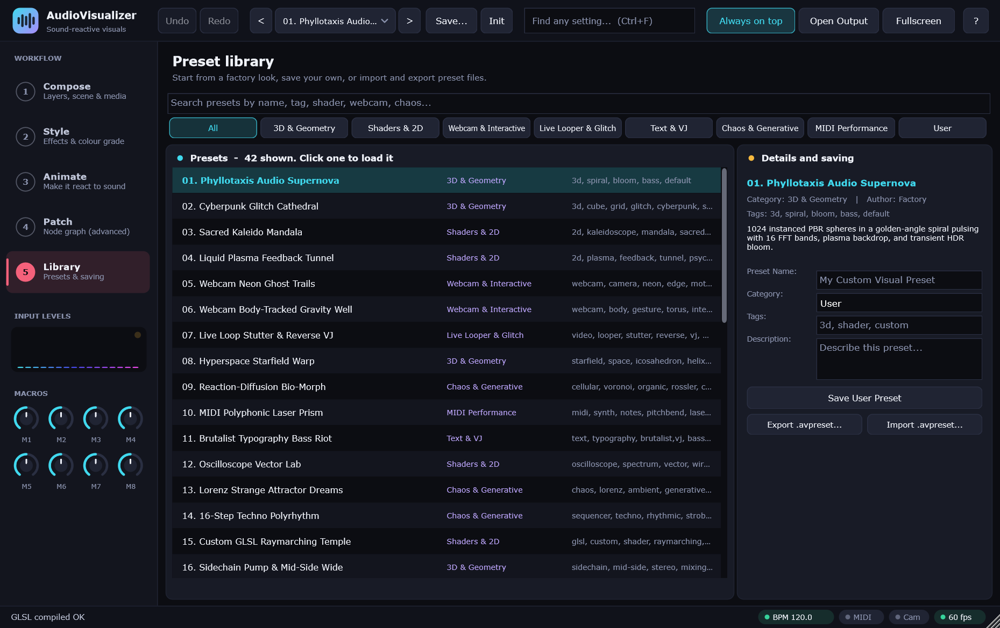

- **42 factory presets** in categories (3D & Geometry, Shaders & 2D, Webcam & Interactive, Live Looper & Glitch, Text & VJ, Chaos & Generative, MIDI Performance). Search by name or tag.
- **Save…** stores your own preset (name, category, tags, description) in `Documents/AudioVisualizer/Presets` as `.avpreset`.
- **Export / Import** a single preset file to share it.
- A preset stores **everything**: layers and their kinds, settings, text and fonts, effects, modulation, node graph and shader code.

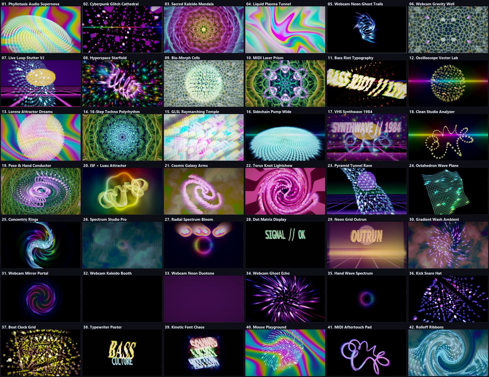

Your DAW project also saves the full state, so sessions reopen exactly as you left them.

## 10. Webcam, video and MIDI

### Webcam

1. On a **Video & Loop** or **Webcam FX** layer, choose a camera from the dropdown.
2. For the **Video & Loop** layer set **Source → Live webcam (direct)** to show it straight away, or use the loop recorder.
3. Hand, head and motion tracking feed `pose.*` and `cam.*` sources.

Camera capture works on **Windows and macOS**. (JUCE has no camera support on Linux.)

### Video files

Load a video or image from the Video & Loop layer. Videos are decoded in the background and cached for instant scrubbing, reverse and beat stutter. **Windows decodes video files** (Media Foundation); on **macOS and Linux only still images load**.

### Live loop

**Record / stop loop** captures the camera into a loop buffer. Set the loop range, speed, reverse, **tempo sync** (loop length in beats) and **beat stutter**.

### MIDI

Notes, velocity, pitch bend, aftertouch, mod wheel, sustain and any controller (`cc.N`) are sources. The *MIDI Aftertouch Pad* and *MIDI Polyphonic Laser Prism* presets are good examples.

## 11. Keyboard shortcuts

| Keys | Action |
|---|---|
| `Ctrl+Z` / `Ctrl+Y` | Undo / redo (use `Cmd` on macOS) |
| `Ctrl+F` | Search every setting |
| `Esc` | Clear the search box |
| `F11` or `Alt+Enter` | Fullscreen (output window) |
| `Esc` | Leave fullscreen (output window) |
| `T` | Toggle always-on-top (output window) |
| Double-click a slider | Reset it |
| Right-click a slider | Assign a modulation source |

## 12. Troubleshooting

| Problem | Try this |
|---|---|
| **Black output window** | Make sure at least one layer is **switched on** (an amber "Layer is OFF" notice appears) and that its **opacity** isn't 0 |
| **Nothing reacts** | The plugin needs audio. Check the *Input levels* meter in the left rail. In the standalone app, enable an input device in Options |
| **Webcam layers are black** | Choose a camera in the dropdown. Webcam works on Windows and macOS only |
| **A custom shader shows an error** | The status bar shows the GLSL message. Fix the code and click *Compile & apply* |
| **The output window hides behind my DAW** | Switch **Always on top** on |
| **macOS says the plugin is damaged** | Run `xattr -dr com.apple.quarantine <file>` |
| **Slow frame rate** | Lower **Copies**, switch off bloom or feedback, shrink the output window, or remove layers |

Still stuck? [Open an issue](../../../issues) and say what you were doing.

## 13. About, support and licence

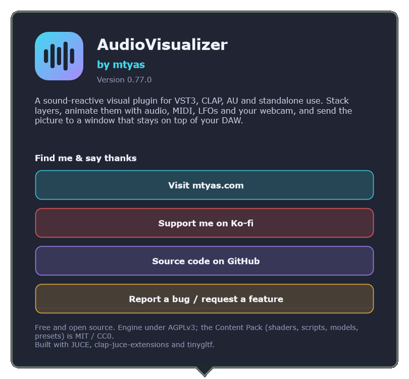

AudioVisualizer is made by **mtyas** and is free.

- 🌐 [mtyas.com](https://mtyas.com)
- ☕ [ko-fi.com/mtyas](https://ko-fi.com/mtyas): if it's useful, a coffee helps me keep building
- 💻 [github.com/mtyas/AudioVisualizer](https://github.com/mtyas/AudioVisualizer)

The same links are inside the plugin on **About & support**.

The core engine is **AGPLv3**. The Content Pack (shaders, scripts, WASM modules, glTF models, presets) is **MIT / CC0**. Built with [JUCE](https://juce.com), [clap-juce-extensions](https://github.com/free-audio/clap-juce-extensions) and [tinygltf](https://github.com/syoyo/tinygltf).

